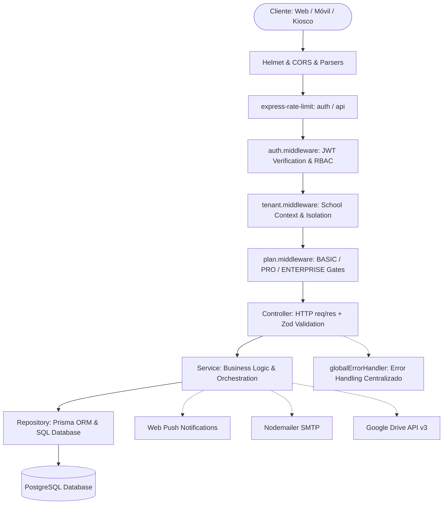
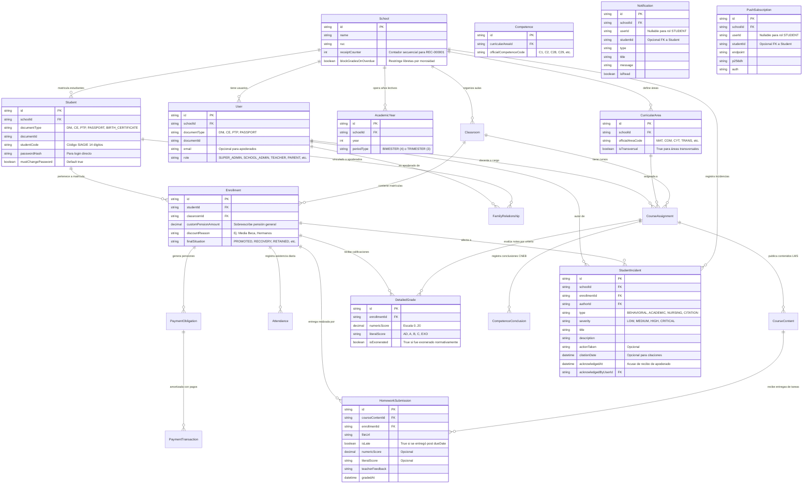

# SaaSchool Backend — Documentación Técnica Integral de Arquitectura y Funcionalidades

> **Versión:** 1.2.0 (Jerarquía Curricular CNEB, Motor SIAGIE Oficial y Conexiones Transversales)  
> **Plataforma:** SaaSchool — SaaS B2B Multi-Tenant para Gestión Escolar (Perú / MINEDU / SIAGIE / CNEB)  
> **Entorno de Ejecución:** Node.js 18+ | Express 4.x | TypeScript 5.x (Strict Mode)  
> **Base de Datos y ORM:** PostgreSQL 16+ con Prisma ORM 5.22  
> **Protocolos & Servicios:** JWT, Web Push (VAPID RFC 8292), Nodemailer SMTP, Google Drive API v3, Multer Temporary Disk Storage  

---

## 1. Arquitectura General y Filosofía del Sistema

El backend de **SaaSchool** está diseñado bajo los principios de **Domain-Driven Design (DDD) simplificado**, **Programación Orientada a Objetos (POO)** y principios **SOLID**.

### 1.1 Estructura Estricta por Módulo
Cada funcionalidad del sistema reside en `src/modules/[module-name]/` y está desacoplada en 5 capas:
1. **`[entity].routes.ts`**: Declaración de endpoints HTTP, asociación de middlewares de seguridad (`authMiddleware`, `tenantMiddleware`, `requirePlan`, `authorizeRoles`) y mapeo a métodos del controlador.
2. **`[entity].schema.ts`**: Esquemas de validación Zod con tipado estricto (`z.infer`), validación sintáctica de formatos (DNI 8 dígitos, Códigos SIAGIE 14 dígitos, Ubigeos 6 dígitos, UUIDs) y transformaciones.
3. **`[entity].controller.ts`**: Clase encargada del protocolo HTTP (`Request`, `Response`), parseo de entradas (`req.body`, `req.params`, `req.query`), delegación inmediata al servicio y respuesta con estructura JSON estandarizada.
4. **`[entity].service.ts`**: Clase con la lógica de negocio pura, reglas del CNEB/MINEDU, control de cuotas por plan, generación de notificaciones reactivas y cálculos matemáticos. Recibe sus repositorios vía **Inyección de Dependencias** en el constructor.
5. **`[entity].repository.ts`**: Única capa con acceso directo a Prisma Client. Todos los métodos de consulta (`findMany`, `findFirst`, `update`, `delete`) exigen obligatoriamente el parámetro `schoolId` para garantizar la hermeticidad de datos entre colegios (Multi-Tenancy).

---

## 2. Infraestructura Base, Seguridad y Middlewares Core

### 2.1 Configuración de Entorno (`src/config/env.ts`)
Valida mediante Zod que todas las variables requeridas existan al inicializar el servidor. Si falta una variable crítica, aborta la ejecución con `process.exit(1)`.

* **Variables Validadas:**
  * `DATABASE_URL`: URI de conexión a PostgreSQL con SSL/pooling.
  * `JWT_SECRET`: Clave simétrica de al menos 16 caracteres para la firma de tokens.
  * `JWT_EXPIRES_IN`: Tiempo de vida del JWT (por defecto `'7d'`).
  * `PORT`: Puerto TCP de escucha (por defecto `3000`).
  * `NODE_ENV`: Entorno (`development`, `production`, `test`).
  * `BCRYPT_ROUNDS`: Rondas de sal para encriptación de claves (por defecto `12`).
  * `USER_EMAIL` y `PASS_EMAIL`: Credenciales SMTP de Gmail para Nodemailer.
  * `VAPID_PUBLIC_KEY`, `VAPID_PRIVATE_KEY`, `VAPID_SUBJECT`: Claves VAPID para notificaciones Web Push.
  * `GOOGLE_CLIENT_ID`, `GOOGLE_CLIENT_SECRET`, `GOOGLE_REFRESH_TOKEN`, `GOOGLE_DRIVE_FOLDER_ID`: Credenciales OAuth2 para almacenamiento en Google Drive.

### 2.2 Prisma Client Singleton (`src/config/prisma.ts`)
Exporta una instancia única de `PrismaClient` asignada a `globalThis` en entornos de desarrollo para evitar saturar el pool de conexiones de PostgreSQL con recargas en caliente (`ts-node-dev`). En desarrollo registra `['query', 'info', 'warn', 'error']` y en producción solo `['error']`.

### 2.3 Manejador de Errores Operacionales (`src/core/errors/app-error.ts`)
* **Clase `AppError extends Error`**:
  * `message: string`: Descripción legible del error.
  * `statusCode: number`: Código HTTP de respuesta (400, 401, 403, 404, 409, 422, 500).
  * `isOperational: boolean`: Bandera que identifica errores controlados del dominio frente a excepciones inesperadas del runtime.

### 2.4 Middleware Global de Errores (`src/core/middlewares/error-handler.middleware.ts`)
* **Función `globalErrorHandler(error, req, res, next)`**:
  * **ZodError**: Responde con código `422 Unprocessable Entity` y el desglose de errores por campo (`flatten().fieldErrors`).
  * **AppError**: Responde con `error.statusCode` y formato `{ status: 'fail' | 'error', message }`.
  * **PrismaClientKnownRequestError**:
    * Código `P2002` (Violación de restricción única): Identifica el campo duplicado (`documentId`, `studentCode`, `email`, `cellphone`) y emite mensaje contextual en español con código `409 Conflict`.
    * Código `P2025` (Registro no encontrado): Emite `404 Not Found`.
  * **Errores no controlados**: Registra el stack trace en consola y retorna `500 Internal Server Error` sin filtrar detalles sensibles en producción.

### 2.5 Middleware de Autenticación y Roles (`src/core/middlewares/auth.middleware.ts`)
* **Función `authMiddleware(req, res, next)`**:
  * Extrae la cabecera `Authorization: Bearer <token>`.
  * Invoca `verifyToken(token)`. Si expiró o es inválido, arroja `AppError(401)`.
  * Inyecta el usuario decodificado en `req.user` (`userId`, `schoolId`, `role`, `email`).
* **Función `authorizeRoles(...allowedRoles)`**:
  * Higher-Order Middleware que evalúa si `req.user.role` está contenido en la lista blanca de roles. En caso contrario, arroja `AppError('Acceso denegado', 403)`.

### 2.6 Middleware de Tenant (`src/core/middlewares/tenant.middleware.ts`)
* **Función `tenantMiddleware(req, res, next)`**:
  * Verifica que `req.user.schoolId` esté presente.
  * **Soporte de Impersonación para Soporte Técnico**: Si `req.user.role === 'SUPER_ADMIN'` y se envía la cabecera HTTP `x-school-id: <uuid>`, conmuta `req.user.schoolId` al colegio objetivo.
  * Valida en PostgreSQL (`prisma.school.findUnique`) que el colegio exista y esté activo (`isActive: true`). Si no existe, invalida la sesión con `401`.

### 2.7 Middleware de Control de Planes (`src/core/middlewares/plan.middleware.ts`)
* **Función `requirePlan(...allowedPlans)`**:
  * Evalúa el plan activo del colegio (`BASIC`, `PRO`, `ENTERPRISE`).
  * Otorga bypass automático al rol `SUPER_ADMIN`.
  * Verifica `school.planExpiresAt`: Si la fecha actual superó el vencimiento, bloquea la petición con `403`.
  * Si el plan actual no está dentro de los permitidos, arroja `AppError(403)` indicando la necesidad de escalar el plan.

### 2.8 Rate Limiters (`src/core/middlewares/rate-limiter.middleware.ts`)
* **`authRateLimiter`**: Aplica en `/api/auth/*`. Ventana de 15 minutos, máximo 100 intentos por IP.
* **`apiRateLimiter`**: Aplica en `/api/*`. Ventana de 15 minutos, máximo 300 peticiones por IP.

---

## 3. Utilidades Generales (`src/utils/`)

### 3.1 Criptografía y Hash (`src/utils/hash.util.ts`)
* **`hashPassword(plainPassword: string): Promise<string>`**: Genera el hash utilizando `bcryptjs` con las rondas configuradas en `env.BCRYPT_ROUNDS` (12).
* **`comparePassword(plainPassword: string, hashedPassword: string): Promise<boolean>`**: Compara en tiempo constante la clave plana con el hash guardado.

### 3.2 Manejo de JWT (`src/utils/jwt.util.ts`)
* **`signToken(payload: AuthenticatedUser): string`**: Emite un JWT con el secret institucional y tiempo de expiración (`7d`).
* **`verifyToken(token: string): AuthenticatedUser`**: Decodifica el token. Lanza `AppError('El token ha expirado', 401)` o `AppError('Token inválido', 401)`.

### 3.3 Zona Horaria Oficial Escolar (`src/utils/timezone.util.ts`)
Resuelve el problema de desface de horas y fechas cuando la API se despliega en servidores con horario UTC (Render, Railway, AWS).
* **`getSchoolNow(timeZone = 'America/Lima'): SchoolNowResult`**:
  * Utiliza `Intl.DateTimeFormat` para calcular la fecha local exacta en Perú.
  * Retorna:
    * `dateStr`: Cadena `'YYYY-MM-DD'`.
    * `dateObj`: Objeto `Date` normalizado en `00:00:00.000Z` para columnas PostgreSQL `@db.Date`.
    * `hour`: Hora local (0..23).
    * `minute`: Minuto local (0..59).
    * `fullDate`: Instante Date actual.
* **`parseSchoolDate(dateStr: string): Date`**: Convierte `'YYYY-MM-DD'` a objeto Date medianoche UTC.

### 3.4 Notificaciones por Correo (`src/utils/notification.util.ts`)
* **`getMailTransporter(): Transporter | null`**: Configura y reutiliza el transporte SMTP de Gmail (`nodemailer`) con `USER_EMAIL` y `PASS_EMAIL`.
* **`sendEmail(options: EmailOptions): Promise<boolean>`**: Envía correos con soporte HTML y texto plano. Si no hay credenciales SMTP configuradas, simula el envío registrándolo en consola sin interrumpir la operación.
* **`sendReminderNotification(params: ReminderNotificationParams): Promise<ReminderNotificationResult[]>`**: Genera y envía un correo formal con diseño responsivo HTML detallando concepto, estudiante, monto a pagar formateado en Soles (`S/`) y fecha de vencimiento.

### 3.5 Web Push Notifications (`src/utils/web-push.util.ts`)
* **`sendWebPushNotification(subscription, payload): Promise<{ success: boolean; shouldRemove: boolean }>`**:
  * Envía notificaciones Push nativas para celulares y navegadores usando el protocolo VAPID.
  * Si el servidor push de Google/Apple responde con código `404` o `410` (Gone / Not Found), marca `shouldRemove: true` para que el servicio limpie automáticamente las suscripciones caducadas de la base de datos.

---

## 4. Documentación Detallada de los 20 Módulos del Sistema

---

### Módulo 1: `auth` — Autenticación y Control de Acceso

* **Ruta Base:** `/api/auth`
* **Rate Limiting:** `authRateLimiter` (100 peticiones / 15 min)

#### Funciones y Métodos

##### 1. `POST /api/auth/login`
* **Controlador:** `authController.login`
* **Esquema:** `loginSchema` (`email`: string min 3; `password`: string min 1).
* **Servicio:** `AuthService.login(loginDto: LoginDto)`
  * **Qué hace:** Autentica a usuarios regulares (Docentes, Administradores, Apoderados) y Estudiantes mediante **Login Dual Polimórfico**:
    1. Busca primero en la tabla `User` por correo electrónico o documento de identidad.
    2. Si no existe en `User`, busca automáticamente en la tabla `Student` por `documentId` (DNI/CE/PTP) o `studentCode` (Código SIAGIE).
    3. **Auto-inicialización de Alumno:** Si el estudiante no tiene `passwordHash` aún, compara la contraseña ingresada con su propio número de documento (`student.documentId`). Si coincide, hashea la contraseña, activa `mustChangePassword: true` y firma el JWT con `role: 'STUDENT'` y `studentId: student.id`.
  * **Necesita:** Identificador (correo, DNI, carnet de extranjería o código SIAGIE) y contraseña.
  * **Repositorio:** `AuthRepository.findUserByIdentifier(identifier)` y `AuthRepository.findStudentByIdentifier(identifier)`.
  * **Retorna:** `200 OK` con `{ token, user: { id, email, role, firstName, lastNamePaternal, schoolId, documentId, studentId, mustChangePassword } }`.
  * **Errores:** `401 Credenciales inválidas`, `403 Cuenta desactivada`.

##### 2. `POST /api/auth/change-password`
* **Middlewares:** `authMiddleware`.
* **Controlador:** `authController.changePassword`
* **Esquema:** `changePasswordSchema` (`currentPassword`: string opcional; `newPassword`: string min 6).
* **Servicio:** `AuthService.changePassword(userId: string, changePasswordDto: ChangePasswordDto, role?: string)`
  * **Qué hace:** Permite cambiar la clave a cualquier usuario autenticado, soportando tanto cuentas de usuario regular (`User`) como cuentas de estudiantes (`Student`). Valida la clave actual si fue suministrada y comprueba que la nueva clave no sea idéntica al documento de identidad. Actualiza `mustChangePassword: false`.
  * **Retorna:** `200 OK` con `{ message: 'Contraseña actualizada exitosamente' }`.
  * **Errores:** `400 Clave actual incorrecta`, `400 Clave idéntica al documento`, `404 Usuario no encontrado`.

##### 3. `POST /api/auth/register`
* **Controlador:** `authController.register`
* **Esquema:** `registerSchema` (valida `schoolId`, `email`, `password` min 8, nombres y rol).
* **Servicio:** `AuthService.register(registerDto: RegisterDto)`
  * **Qué hace:** Registra un nuevo usuario con clave hasheada mediante bcrypt (12 rondas).
  * **Retorna:** `201 Created` con `{ token, user }`.
  * **Errores:** `409 Ya existe un usuario con ese email`.

---

### Módulo 2: `schools` — Gestión de Colegios (Tenants)

* **Ruta Base:** `/api/schools`
* **Seguridad:** `authMiddleware`, `authorizeRoles` según endpoint.

#### Funciones y Métodos

##### 1. `GET /api/schools`
* **Permisos:** `SUPER_ADMIN`.
* **Servicio:** `SchoolService.getAllSchools()`
* **Repositorio:** `SchoolRepository.findAll()`
* **Retorna:** Lista de todos los colegios registrados en la plataforma.

##### 2. `GET /api/schools/:id`
* **Permisos:** Todos los roles autenticados.
* **Servicio:** `SchoolService.getSchoolById(schoolId)`
* **Retorna:** `200 OK` con la entidad del colegio. Si no existe, arroja `404`.

##### 3. `POST /api/schools` (Onboarding Transaccional)
* **Permisos:** `SUPER_ADMIN`.
* **Esquema:** `createSchoolSchema` (valida RUC 11 dígitos, modularCode, localCode, correo, teléfono peruano, plan `BASIC`/`PRO`/`ENTERPRISE` y datos opcionales del administrador inicial).
* **Servicio:** `SchoolService.createSchool(dto)`
* **Repositorio:** `SchoolRepository.create(dto)`
  * **Qué hace:** En una transacción `prisma.$transaction`, crea el registro del colegio y opcionalmente crea de inmediato el usuario `SCHOOL_ADMIN` asignado a dicho colegio con su contraseña hasheada.
  * **Retorna:** `201 Created`.

##### 4. `PATCH /api/schools/:id`
* **Permisos:** `SUPER_ADMIN`, `SCHOOL_ADMIN`.
* **Esquema:** `updateSchoolSchema` (permite actualizar teléfono permisivo 6-20 chars, niveles educativos ofrecidos `offeredLevels`, dirección, logoUrl, y la política institucional `blockGradesOnOverdue`: booleano para restringir libretas escolares a apoderados y alumnos con pensiones vencidas).
* **Servicio:** `SchoolService.updateSchool(schoolId, dto)`
* **Retorna:** `200 OK` con el colegio actualizado.

##### 5. `DELETE /api/schools/:id` y `PATCH /api/schools/:id/reactivate`
* **Permisos:** `SUPER_ADMIN`.
* **Servicio:** `SchoolService.deactivateSchool` / `reactivateSchool`
* **Qué hace:** Realiza soft-delete cambiando `isActive: false` o `isActive: true`.

##### 6. `POST /api/schools/:id/reset-admin-password`
* **Permisos:** `SUPER_ADMIN`.
* **Servicio:** `SchoolService.resetAdminPassword(schoolId, newPassword)`
  * **Qué hace:** Localiza al administrador activo del colegio (`role: 'SCHOOL_ADMIN'`) y actualiza su hash con la nueva contraseña.
  * **Retorna:** `200 OK` con el correo del admin actualizado.

---

### Módulo 3: `users` — Directorio Institucional de Usuarios

* **Ruta Base:** `/api/users`
* **Seguridad:** `authMiddleware`, `tenantMiddleware`.

#### Funciones y Métodos

##### 1. `GET /api/users`
* **Permisos:** `SUPER_ADMIN`, `SCHOOL_ADMIN`, `ADMINISTRATIVE`, `TEACHER`.
* **Filtros (Query):** `userFilterSchema` (`page`, `limit`, `role`, `roles`, `staffOnly`, `search`).
* **Servicio:** `UserService.getAllUsers(schoolId, filters)`
  * **Qué hace:** Consulta usuarios filtrando por búsqueda (nombre, apellidos, email, documento), rol específico o filtro de personal (`staffOnly = true` devuelve administradores y profesores). Oculta el hash de contraseña.
  * **Retorna:** `PaginatedResult<Omit<User, 'passwordHash'>>`.

##### 2. `POST /api/users`
* **Permisos:** `SUPER_ADMIN`, `SCHOOL_ADMIN`, `ADMINISTRATIVE`.
* **Esquema:** `createUserSchema` (documentType: `'DNI' | 'CE' | 'PTP' | 'PASSPORT'`, documentId, nombres, apellidos paterno y materno, celular 9 dígitos, email opcional/nullable para apoderados sin correo, password min 8).
* **Servicio:** `UserService.createUser(schoolId, dto)`
  * **Qué hace:** Valida unicidad de correo (si está presente) y número de documento dentro del colegio. Hashea la clave con bcrypt y crea el usuario. Permite apoderados polimórficos sin email que inician sesión con su documento de identidad.
  * **Retorna:** `201 Created`.

##### 3. `GET /api/users/:id`, `PATCH /api/users/:id`, `DELETE /api/users/:id`, `PATCH /api/users/:id/reactivate`
* **Qué hace:** Operaciones CRUD con soft delete (`isActive: false`) y reactivación (`isActive: true`).

##### 4. `GET /api/users/:userId/students`
* **Qué hace:** Devuelve todos los hijos vinculados al apoderado especificado vía `familyRelationshipController.getByParent`.

---

### Módulo 4: `students` — Alumnos, Ficha de Matrícula SIAGIE y Nóminas

* **Ruta Base:** `/api/students`
* **Seguridad:** `authMiddleware`, `tenantMiddleware`.

#### Funciones y Métodos

##### 1. `GET /api/students/catalogs`
* **Servicio:** `StudentService.getCatalogs()`
* **Qué hace:** Retorna los catálogos estáticos oficiales del SIAGIE (Departamentos, Provincias, Distritos con códigos Ubigeo INEI de 6 dígitos, tipos de discapacidad, lenguas maternas y tipos de documento incluyendo soporte para `DNI`, `CE`, `PTP`, `PASSPORT`, `BIRTH_CERTIFICATE`). Además, el modelo `Student` soporta credenciales directas (`passwordHash`, `mustChangePassword`) para permitir que los alumnos (Secundaria) inicien sesión directamente con su documento o código SIAGIE.

##### 2. `POST /api/students/ficha-matricula` (Ficha Unificada Transaccional)
* **Permisos:** `SUPER_ADMIN`, `SCHOOL_ADMIN`, `ADMINISTRATIVE`.
* **Esquema:** `registerFichaMatriculaSchema`
* **Servicio:** `StudentService.registerFichaMatricula(schoolId, dto)`
  * **Lógica Crítica:**
    1. Verifica la cuota de estudiantes del colegio según su plan de suscripción (`BASIC`: 150 alumnos, `PRO`: 600 alumnos, `ENTERPRISE`: ilimitado). Si se supera la cuota, bloquea con `403`.
    2. En una transacción atómica `prisma.$transaction`:
       * Crea o actualiza el estudiante con su código SIAGIE (14 dígitos), DNI (8 dígitos) y Ubigeo (6 dígitos).
       * Crea la matrícula (`Enrollment`) para el año escolar y aula indicada.
       * Si el apoderado es nuevo (`mode: 'NEW'`), crea el usuario con `role: 'PARENT'` y asigna como contraseña inicial su número de DNI.
       * Crea el vínculo familiar en `FamilyRelationship` marcando si es apoderado legal y/o responsable económico.
  * **Retorna:** `201 Created` con el ID del estudiante, matrícula y apoderado.

##### 3. `GET /api/students/nomina-matricula/:classroomId`
* **Permisos:** `SUPER_ADMIN`, `SCHOOL_ADMIN`, `ADMINISTRATIVE`.
* **Servicio:** `StudentService.getNominaMatricula(schoolId, classroomId)`
  * **Qué hace:** Construye la nómina oficial en el formato exacto requerido por el SIAGIE: orden alfabético por apellidos, código modular del colegio, código de estudiante, DNI, fecha de nacimiento, edad al 31 de marzo del año escolar, condición de matrícula (`INGRESANTE`, `CONTINUO`, etc.) y datos del apoderado.
  * **Retorna:** `200 OK` con cabecera de la IE y lista de alumnos formateada para exportar a Excel.

##### 4. `GET /api/students/my-children`
* **Permisos:** `PARENT`.
* **Servicio:** `StudentService.getMyChildren(schoolId, parentUserId)`
  * **Qué hace:** Consulta los estudiantes vinculados al apoderado autenticado, incluyendo su matrícula activa, aula, grado, nivel y pensiones pendientes.

##### 5. `GET /api/students/:id/certificates/enrollment` (Constancia Oficial de Matrícula)
* **Permisos:** `SUPER_ADMIN`, `SCHOOL_ADMIN`, `ADMINISTRATIVE`, `TEACHER`, `PARENT`, `STUDENT`.
* **Servicio:** `StudentService.getEnrollmentCertificate(schoolId, studentId, requester)`
  * **Qué hace:** Emite la constancia oficial de matrícula para el año lectivo activo. Incluye validación de seguridad contra IDOR (si el solicitante es `PARENT`, comprueba filiación legal; si es `STUDENT`, valida que coincida con su identidad).
  * **Retorna:** `200 OK` con datos institucionales completos (nombre del colegio, RUC, código modular, nivel), información del alumno (apellidos, nombres, documento, código SIAGIE), datos de la matrícula (grado, sección, turno, condición) y código único alfanumérico de verificación.

##### 6. `GET /api/students/:id/certificates/no-debt` (Constancia de No Adeudo)
* **Permisos:** `SUPER_ADMIN`, `SCHOOL_ADMIN`, `ADMINISTRATIVE`, `TEACHER`, `PARENT`, `STUDENT`.
* **Servicio:** `StudentService.getNoDebtCertificate(schoolId, studentId, requester)`
  * **Qué hace:** Verifica en la base de datos si el estudiante tiene alguna obligación de pago (`PaymentObligation`) vencida o pendiente (`PENDING` o `PARTIAL`).
  * **Regla de Negocio:** Si existen obligaciones con saldo pendiente, rechaza la solicitud con `AppError('No se puede generar la constancia de no adeudo porque el estudiante registra pagos pendientes o vencidos', 400)` adjuntando el desglose de deudas. Si está al día, emite la constancia con código de verificación institucional.
  * **Retorna:** `200 OK` con `{ certificateType: 'NO_DEBT', student, school, verificationCode, issuedAt }`.

##### 7. `GET /api/students`, `POST /api/students`, `GET /api/students/:id`, `PATCH /api/students/:id`, `DELETE /api/students/:id`
* **Qué hace:** Gestión individual de estudiantes. La eliminación valida previamente si el alumno posee registros académicos o transacciones financieras.

---

### Módulo 5: `family-relationships` — Vínculos Familiares y Apoderados

* **Ruta Base:** `/api/family-relationships`
* **Seguridad:** `authMiddleware`, `tenantMiddleware`.

#### Funciones y Métodos
* **`GET /`**: Lista las relaciones del colegio.
* **`GET /:id`**: Detalle de un vínculo.
* **`POST /`**: Vincula un estudiante (`studentId`) con un usuario (`userId`) indicando `relationshipType` (`MOTHER`, `FATHER`, `TUTOR_LEGAL`, `GRANDPARENT`, `UNCLE_AUNT`, `OTHER`), `isLegalGuardian`, `isFinancialResponsible` y `livesWithStudent`.
* **`PATCH /:id`**: Modifica responsabilidades legales o financieras.
* **`DELETE /:id`**: Elimina el vínculo familiar.

---

### Módulo 6: `academic-years` — Años Lectivos

* **Ruta Base:** `/api/academic-years`
* **Seguridad:** `authMiddleware`, `tenantMiddleware`.

#### Funciones y Métodos
* **`GET /`**: Lista los años lectivos del colegio ordenados de forma descendente por año (`year`).
* **`POST /`**: Crea un año escolar (`year`, `name`, `periodType`: `'BIMESTER'` | `'TRIMESTER'`, `startDate`, `endDate`, `isActive`). Valida que el año no esté duplicado en el colegio. Admite tanto calendario bimestral (4 periodos) como trimestral (3 periodos).
* **`PATCH /:id`**: Actualiza fechas de vigencia o estado.
* **`DELETE /:id`**: Elimina el año escolar **únicamente si no tiene matrículas asociadas** (`countEnrollments === 0`). Si tiene alumnos matriculados, arroja `AppError(400)`.

---

### Módulo 7: `classrooms` — Aulas y Secciones

* **Ruta Base:** `/api/classrooms`
* **Seguridad:** `authMiddleware`, `tenantMiddleware`.

#### Funciones y Métodos
* **`GET /`**: Devuelve todas las aulas del colegio con su tutor asignado (`ClassroomWithTutor`).
* **`POST /`**: Registra un aula (`educationLevel`, `grade`, `section`, `shift`, `capacity`, `tutorTeacherId`).
  * **Validación:** Si se provee `tutorTeacherId`, valida que el usuario exista, pertenezca al mismo colegio, tenga rol `TEACHER` y esté activo.
* **`PATCH /:id`**: Actualiza datos o reasigna el docente tutor.
* **`DELETE /:id`**: Elimina el aula previa comprobación de integridad referencial.

---

### Módulo 8: `course-assignments` — Asignaciones Docentes y Carga Horaria

* **Ruta Base:** `/api/course-assignments`
* **Seguridad:** `authMiddleware`, `tenantMiddleware`.

#### Funciones y Métodos

##### 1. `GET /api/course-assignments/my-courses`
* **Permisos:** `TEACHER`, `SCHOOL_ADMIN`, `SUPER_ADMIN`.
* **Servicio:** `CourseAssignmentService.getMyAssignments(teacherId, schoolId)`
* **Qué hace:** Retorna la lista de aulas y materias que el docente autenticado tiene a su cargo.

##### 2. `POST /api/course-assignments`
* **Permisos:** `SCHOOL_ADMIN`, `SUPER_ADMIN`.
* **Qué hace:** Asigna un docente a un curso específico dentro de un aula (`classroomId`, `areaId`, `teacherId`). Aplica restricción única: un curso en un aula tiene un solo docente titular.

##### 3. `POST /api/course-assignments/bulk` (Unidocencia Inicial y Primaria)
* **Permisos:** `SCHOOL_ADMIN`, `SUPER_ADMIN`.
* **Esquema:** `bulkAssignUnidocenteSchema` (`classroomId`, `teacherId`, `areaIds: string[]`).
* **Qué hace:** Asigna de forma masiva todas las áreas curriculares de un aula a un mismo docente (modelo de maestro polidocente completo o unidocente).

##### 4. `POST /api/course-assignments/sync-teacher`
* **Permisos:** `SCHOOL_ADMIN`, `SUPER_ADMIN`.
* **Esquema:** `syncTeacherAssignmentsSchema` (`teacherId`, `assignments: Array<{ classroomId, areaId }>`).
* **Qué hace:** Sincronización tipo checklist de la carga completa del docente. Crea las asignaciones nuevas y elimina de forma limpia las desmarcadas que no posean notas registradas.

##### 5. `DELETE /api/course-assignments/:id`
* **Qué hace:** Elimina una asignación docente verificando pertenencia al colegio.

---

### Módulo 9: `course-contents` — Aula Virtual y LMS Ligero

* **Ruta Base:** `/api/course-contents`
* **Seguridad:** `authMiddleware`, `tenantMiddleware`.

#### Funciones y Métodos

##### 1. `GET /api/course-contents/assignment/:assignmentId`
* **Filtro:** `?bimester=1..4`
* **Qué hace:** Devuelve publicaciones del aula virtual (material de clase, tareas con fecha límite y foros de debate).

##### 2. `POST /api/course-contents`
* **Permisos:** `SUPER_ADMIN`, `SCHOOL_ADMIN`, `TEACHER`.
* **Esquema:** `createCourseContentSchema` (`courseAssignmentId`, `bimester`, `contentType`: `'LESSON_MATERIAL' | 'HOMEWORK' | 'FORUM'`, `title`, `description`, `fileUrl`, `fileName`, `fileType`, `fileSize`, `dueDate`).
* **Servicio:** Valida que el docente sea el titular del curso o un directivo. Publica el recurso educativo.

##### 3. `GET /api/course-contents/:id/comments` y `POST /api/course-contents/:id/comments`
* **Qué hace:** Foros de debate interactivo. Permite a docentes, alumnos y padres participar e intercambiar comentarios. Valida que el tipo sea estrictamente `'FORUM'`.

##### 4. Endpoints de Supervisión Pedagógica (Dirección)
* **`GET /supervision/stats`**: Métricas globales de publicaciones del colegio por bimestre.
* **`GET /supervision/teacher-compliance`**: Auditoría de cumplimiento de subida de clases y tareas por cada profesor.
* **`GET /supervision/feed`**: Feed cronológico de todo el material publicado en la institución con filtros por nivel, grado, profesor y tipo.

##### 5. Entregas y Calificación de Tareas en Aula Virtual (`HomeworkSubmission`)
* **Modelo Asociado:** `HomeworkSubmission` indexado por `[schoolId, courseContentId]` y con clave única `@@unique([courseContentId, enrollmentId])`.
* **Endpoints Implementados:**
  * **`POST /api/course-contents/:id/submissions`**:
    * **Permisos:** `STUDENT`, `PARENT`, `SUPER_ADMIN`, `SCHOOL_ADMIN`.
    * **Esquema:** `submitHomeworkSchema` (`fileUrl`, `fileName`, `fileSize`, `studentComment`).
    * **Lógica:** Valida que la publicación sea de tipo `HOMEWORK`. Si la fecha de envío supera el `dueDate` de la tarea, marca automáticamente `isLate: true`. Registra o actualiza (`upsert`) la entrega por estudiante.
  * **`GET /api/course-contents/:id/submissions`**:
    * **Permisos:** `SUPER_ADMIN`, `SCHOOL_ADMIN`, `ADMINISTRATIVE`, `TEACHER`, `STUDENT`, `PARENT`.
    * **Lógica:** Si el solicitante es Docente o Directivo, lista la totalidad de alumnos matriculados en el aula con su estado (`CALIFICADA`, `ENTREGADA` o `PENDIENTE`). Si es Estudiante o Apoderado, retorna únicamente su propia entrega.
  * **`PATCH /api/course-contents/submissions/:submissionId/grade`**:
    * **Permisos:** `SUPER_ADMIN`, `SCHOOL_ADMIN`, `TEACHER`.
    * **Esquema:** `gradeSubmissionSchema` (`numericScore`, `literalScore`, `teacherFeedback`).
    * **Lógica:** Valida permisos de autoría del docente, persiste la calificación y retroalimentación con `gradedAt: new Date()` y dispara automáticamente una notificación In-App al apoderado/estudiante para alertar sobre la nota obtenida.

---

### Módulo 10: `curricular-areas` — Áreas Curriculares y Competencias CNEB (Jerarquía Oficial vs. Sub-cursos)

* **Ruta Base:** `/api/curricular-areas`
* **Seguridad:** `authMiddleware`, `tenantMiddleware`.

#### Jerarquía Curricular CNEB (v1.2.0)
* **Área Curricular Oficial Madre (`parentAreaId === null`):** Representa las asignaturas oficiales del Ministerio de Educación (ej. *Matemática*, *Comunicación*, *Ciencia y Tecnología*, *Personal Social*). Sus competencias (`Competence`) son las oficiales aprobadas en el CNEB.
* **Sub-curso o Rama Interna (`parentAreaId !== null`):** Representa las ramas desagregadas de colegios particulares (ej. *Aritmética*, *Álgebra*, *Geometría*, *Física*, *Química*, *Biología*).
* **Filtro de Competencias Evaluadas (`evaluatedCompetenceIds: string[]`):** Permite que un sub-curso evalúe un subconjunto específico de las competencias de su Área Madre (ej. *Aritmética* evalúa `C1`, *Geometría* evalúa `C3`). Si el arreglo está vacío `[]`, evalúa todas las competencias de su Área Madre.

#### Funciones y Métodos

##### 1. `POST /api/curricular-areas/seed-minedu`
* **Permisos:** `SUPER_ADMIN`, `SCHOOL_ADMIN`.
* **Servicio:** `CurricularAreaService.seedMineduCurriculum(schoolId)`
  * **Qué hace:** Siembra automáticamente en el colegio la malla oficial exacta del CNEB diferenciada por nivel:
    * **Nivel `INITIAL`:** Personal Social (3 comp), Psicomotriz (1 comp), Comunicación (4 comp), Matemática (2 comp: C1 Cantidad y C2 Forma/Movimiento), Ciencia y Tecnología (1 comp), Transversales (2 comp: C28 y C29).
    * **Nivel `PRIMARY`:** Personal Social (5 comp), Educación Física (3 comp), Arte y Cultura (2 comp), Comunicación (3 comp), Inglés (3 comp), Matemática (4 comp), Ciencia y Tecnología (3 comp), Educación Religiosa (2 comp), Transversales (2 comp).
    * **Nivel `SECONDARY`:** DPCC (2 comp), Ciencias Sociales (3 comp), EPT (1 comp), Educación Física (3 comp), Arte y Cultura (2 comp), Comunicación (3 comp), Inglés (3 comp), Matemática (4 comp), Ciencia y Tecnología (3 comp), Educación Religiosa (2 comp), Transversales (2 comp).

##### 2. `POST /api/curricular-areas/:id/load-default-competences`
* **Qué hace:** Detecta el código oficial del área (`MAT`, `CYT`, `COM`, `DPCC`, `EPT`, etc.) e inyecta las competencias estándar aprobadas por el MINEDU evitando duplicados.

##### 3. `POST /api/curricular-areas/competences` y `PATCH /api/curricular-areas/competences/:id`
* **Qué hace:** Creación, edición y activación/desactivación de competencias evaluativas con código oficial (`officialCompetenceCode`: `'C1'`, `'C2'`, `'C28'`, `'C29'`).

##### 4. `DELETE /api/curricular-areas/:id`
* **Validación de Integridad:** Comprueba que el área no tenga asignaciones docentes ni calificaciones guardadas antes de permitir el borrado.

---

### Módulo 11: `enrollments` — Matrículas

* **Ruta Base:** `/api/enrollments`
* **Seguridad:** `authMiddleware`, `tenantMiddleware`.

#### Funciones y Métodos
* **`GET /`**: Lista de matrículas con datos del alumno, aula y año lectivo.
* **`POST /`**: Crea una matrícula individual (`studentId`, `academicYearId`, `classroomId`, `condition`, `repeatingGrade`, `customPensionAmount`, `discountReason`, `finalSituation`).
* **`PATCH /:id`**: Actualiza el aula, estado (`REGISTERED`, `TRANSFERRED`, `WITHDRAWN`), beca, monto personalizado o situación final SIAGIE.
  * **Cancelación Automática de Pensiones Futuras:** Si el estado cambia a `'WITHDRAWN'` o `'TRANSFERRED'`, cancela automáticamente dentro de la transacción todas las obligaciones pendientes futuras (`dueDate > now()`).
  * **Conexión 3 — Migración Automática de Notas entre Salones (v1.2.0):** Si un estudiante cambia de sección (`classroomId`), el sistema migra atómicamente dentro de la misma transacción todas sus notas detalladas (`DetailedGrade`) y conclusiones descriptivas (`CompetenceConclusion`) desde las asignaciones del aula de origen hacia las asignaciones coincidentes en área curricular (`areaId`) del aula de destino, evitando la pérdida de récord académico.

---

### Módulo 12: `grades` — Calificaciones, Rúbricas y Consolidado SIAGIE

* **Ruta Base:** `/api/grades`
* **Seguridad:** `authMiddleware`, `tenantMiddleware`, `requirePlan('PRO', 'ENTERPRISE')`.

#### Funciones y Métodos

##### 1. Gestión de Rúbricas y Criterios Evaluativos (`/criteria`)
* **`GET /criteria`**, **`POST /criteria`**, **`PUT /criteria/:id`**, **`DELETE /criteria/:id`**:
  * Configura los criterios evaluativos institucionales (ej: Práctica Calificada `PC`, Examen Bimestral `EB`, Tareas `TAREAS`).

##### 2. `GET /api/grades/matrix` (Matriz de Calificaciones con Herencia y Métricas de Incidencias)
* **Parámetros:** `courseAssignmentId`, `periodNumber` (1..4).
* **Herencia en Sub-cursos:** Si el curso es un sub-curso (`parentAreaId !== null`), carga las competencias activas de su Área Madre filtrando exclusivamente por `evaluatedCompetenceIds`.
* **Conexión 4 — Inyección de Incidencias en la Matriz:** Cada estudiante matriculado incluye su resumen de incidencias (`incidentsSummary`: `{ total, topics, convivencia, acoso }`) calculadas dentro del rango oficial de fechas del periodo evaluado.

##### 3. `POST /api/grades/matrix/batch` (Guardado Masivo Atómico)
* **Esquema:** `saveBatchDetailedGradesSchema` (acepta `literalScore: 'AD' | 'A' | 'B' | 'C' | 'EXO' | '-'`).
* **Soporte Guion Oficial SIAGIE (`'-'`):** Representa "Sin evaluación / No se cuenta con evidencia suficiente en el periodo". Tanto `EXO` como `'-'` se excluyen del denominador al promediar.

##### 4. Conexión 1 — `POST /api/grades/matrix/sync-homework` (Sincronización LMS -> Matriz)
* **Parámetros:** `{ courseAssignmentId, periodNumber }`.
* **Servicio:** `GradeService.syncHomeworkToMatrix(schoolId, courseAssignmentId, periodNumber)`
* **Qué hace:** Verifica que el periodo no esté cerrado. Busca el criterio con nombre corto `'TAREAS'` (o primer criterio activo). Recupera todas las tareas publicadas en ese periodo, calcula el promedio de entregas evaluadas por alumno y hace upsert automático en `DetailedGrade`.

##### 5. `GET /api/grades/report-card/:enrollmentId` (Libreta Oficial con Asistencia por Periodos)
* **Conexión 2 — Asistencia Oficial SIAGIE (`IJ`, `II`, `TJ`, `TI`):** Utiliza `getPeriodDateRange` para desglosar la asistencia de cada periodo escolar según los rangos de fechas de `periodsConfig` del año lectivo, reportando contadores de inasistencias justificadas (`IJ`), inasistencias injustificadas (`II`), tardanzas justificadas (`TJ`) y tardanzas injustificadas (`TI`).

---

### Módulo 13: `siagie-consolidator` — Servicio de Consolidación SIAGIE de Dos Capas

* **Archivo:** `src/modules/grades/siagie-consolidator.service.ts`
* **Lógica:** Implementa la RVM N° 094-2020-MINEDU y la estructura oficial del programa SIAGIE.

#### Capacidades Clave (v1.2.0)
1. **Consolidación de Sub-cursos hacia las Competencias del Área Madre:** En la salida oficial de SIAGIE nunca figuran los sub-cursos sueltos. Las calificaciones de los sub-cursos se agregan directamente bajo su Área Madre oficial (`parentAreaId ?? areaId`) y se promedian en cada competencia respectiva.
2. **Detección de Competencias Oficiales Huérfanas (`unmappedCompetences`):** Audita si alguna competencia de las Áreas Madre del salón no está siendo evaluada por ningún curso asignado, reportando una advertencia detallada a Dirección.
3. **Modos de Cálculo Anual (`annualCalculationMode`):** Soporta tanto `'LAST_PERIOD'` (Nivel de logro conclusivo del último periodo según RVM N° 094-2020) como `'AVERAGE'` (Promedio ponderado anual).
4. **Regla Oficial de Desaprobación y Situación Final:** Un área se considera desaprobada si más del 50% de sus competencias evaluadas tienen calificación literal `'C'`. Alumnos regulares con $\ge 4$ áreas desaprobadas resultan en `RETAINED`.
5. **Sanitización de Conclusiones Descriptivas:** Limita el texto a 300 caracteres, elimina retornos de carro, tabulaciones y comillas dobles, garantizando compatibilidad 100% con las plantillas de Excel de SIAGIE.

---

### Módulo 14: `attendance` — Asistencia Escolar, Kiosco QR y Auto-Cierre

* **Ruta Base:** `/api/attendance`
* **Seguridad:** `authMiddleware`, `tenantMiddleware`.

#### Funciones y Métodos

##### 1. `GET /api/attendance/sheet` y `PUT /api/attendance/sheet` (Pase de Lista Diario)
* **Qué hace:** Permite al tutor cargar y guardar la asistencia del aula para una fecha dada en un único payload, soportando estados `PRESENT`, `LATE_JUSTIFIED`, `LATE_UNJUSTIFIED`, `ABSENT_JUSTIFIED`, `ABSENT_UNJUSTIFIED`.

##### 2. `GET /api/attendance/matrix` (Matriz Sábana Mensual Interactiva)
* **Parámetros:** `classroomId`, `year`, `month`.
* **Qué hace:** Genera la grilla interactiva con los 31 días del mes para cada alumno de la sección, totalizando asistencias, tardanzas y faltas.

##### 3. `POST /api/attendance/scan` (Kiosco en Puerta con Lector QR / Barras)
* **Esquema:** `scanAttendanceSchema` (`code`: string con DNI, código de estudiante SIAGIE o UUID; `timestamp`: opcional).
* **Servicio:** `AttendanceService.scanAttendance(schoolId, userContext, dto)`
  * **Lógica Inteligente y Despacho Asíncrono Fire-and-Forget:**
    1. Resuelve la matrícula del estudiante buscando por DNI, código SIAGIE o ID.
    2. Consulta la configuración horaria del colegio (`AttendanceScheduleConfig`) aplicable al nivel educativo del alumno o general.
    3. Compara la hora local peruana con `entryTime` (ej: 07:45) y `lateToleranceTime` (ej: 08:15).
    4. Clasifica automáticamente:
       * Si hora $\le$ tolerancia $\implies \mathbf{PRESENT}$.
       * Si hora $>$ tolerancia $\implies \mathbf{LATE\_UNJUSTIFIED}$.
    5. Guarda el registro en base de datos (`origin = 'QR_SCAN'`).
    6. **Fire-and-Forget Push:** Dispara la notificación Web Push al apoderado en segundo plano de manera no bloqueante (`void this.sendScanPushNotification(...)`).
    7. **Tiempo de respuesta inmediato:** Retorna la respuesta HTTP al escáner en $< \text{50ms}$, garantizando fluidez total en portería incluso en horas pico de ingreso (500+ alumnos).

##### 4. `GET /api/attendance/config` y `PUT /api/attendance/config`
* **Qué hace:** Configuración de los horarios de entrada, tolerancia de tardanza y hora límite de cierre para Inicial, Primaria, Secundaria o General.

##### 5. `POST /api/attendance/close`
* **Qué hace:** Ejecuta el cierre de asistencia para los alumnos sin marcar en el día, asignándoles falta injustificada con origen `AUTO_CLOSE`.

##### 6. Cron de Auto-Cierre en Segundo Plano (`src/modules/attendance/attendance.cron.ts`)
* **Qué hace:** Tarea periódica con `setInterval` cada 60 segundos (sin dependencias externas). De lunes a viernes, evalúa colegios con `autoCloseEnabled: true` cuya `autoCloseTime` coincida con el minuto actual peruano y ejecuta el cierre asignando faltas automáticamente.

---

### Módulo 15: `payments` — Finanzas, Cobranzas y Recibos

* **Ruta Base:** `/api/payments`
* **Seguridad:** `authMiddleware`, `tenantMiddleware`.

#### Funciones y Métodos

##### 1. `GET /api/payments/summary`
* **Permisos:** `SUPER_ADMIN`, `SCHOOL_ADMIN`.
* **Servicio:** `PaymentService.getFinancialSummary(schoolId)`
* **Retorna:** Monto total facturado, monto total recaudado, monto pendiente, monto vencido moroso y tasa porcentual de morosidad institucional.

##### 2. `POST /api/payments/obligations` (Creación de Obligación Individual)
* **Permisos:** `SUPER_ADMIN`, `SCHOOL_ADMIN`, `ADMINISTRATIVE`.
* **Esquema:** `createObligationSchema` (`title`, `concept`: `'PENSION' | 'MATRICULA' | 'OTHER'`, `amountDue`, `dueDate`, `enrollmentId` o `studentId`, `academicYearId`, `notes`).
* **Servicio:** `PaymentService.createObligation(schoolId, dto)`
  * **Qué hace:** Permite emitir una cuota individual para un alumno específico (por matrícula o por estudiante en su matrícula activa).
  * **Retorna:** `201 Created` con la obligación generada.

##### 3. `POST /api/payments/obligations/bulk` (Generación de Cronograma de Pensiones con Becas)
* **Permisos:** `SUPER_ADMIN`, `SCHOOL_ADMIN`, `ADMINISTRATIVE`.
* **Esquema:** `bulkCreateObligationSchema` (`title`, `concept`: `'PENSION' | 'MATRICULA'`, `amountDue`, `dueDate`, `academicYearId`, `classroomId`: opcional).
* **Servicio:** `PaymentService.bulkCreateObligations(schoolId, dto)`
  * **Lógica de Becas y Descuentos:**
    1. Si `concept === 'PENSION'`, consulta `Enrollment.customPensionAmount`.
    2. Si el estudiante cuenta con `customPensionAmount !== null`, sobreescribe el monto general con su cuota pactada.
    3. Si el monto es `0` (Beca Integral), omite la generación de la deuda para ese estudiante.
    4. Evita duplicados si el concepto ya fue emitido para un alumno.

##### 4. `POST /api/payments/transactions` (Registro de Cobro en Caja y Recibo Autogenerado)
* **Permisos:** `SUPER_ADMIN`, `SCHOOL_ADMIN`, `ADMINISTRATIVE`.
* **Esquema:** `createPaymentTransactionSchema` (`obligationId`, `amountPaid`, `paymentMethod`: `'CASH' | 'BANK_TRANSFER' | 'CREDIT_CARD'`, `operationNumber`, `receiptType`: `'BOLETA' | 'FACTURA'`, `receiptNumber`: opcional, `notes`).
* **Servicio:** `PaymentService.registerTransaction(schoolId, dto)`
  * **Lógica Financiera y Numeración Automática Interna:**
    1. Verifica que la obligación no esté `PAID` ni `CANCELLED`.
    2. Suma pagos previos más el pago actual:
       * Si cubre la totalidad de la deuda $\implies$ actualiza obligación a `PAID`.
       * Si cubre parcialmente $\implies$ actualiza obligación a `PARTIAL`.
    3. **Autonumeración de Recibos Correlativos:** Si no se proporciona `receiptNumber`, el sistema incrementa atómicamente el contador institucional `school.receiptCounter` y genera el código formateado `REC-XXXXXX` (ej. `REC-000001`), evitando duplicidad y garantizando control de auditoría interna sin necesidad de pasarelas ni SUNAT.
    4. Registra la transacción con fecha, método de pago y número correlativo de recibo.

##### 5. `DELETE /api/payments/transactions/:id` (Anulación de Cobro)
* **Qué hace:** Anula un pago registrado por error y recalcula la deuda restante en la obligación asociada, retrocediendo su estado a `PARTIAL` o `PENDING`.

##### 6. `GET /api/payments/transactions/:id/receipt`
* **Qué hace:** Retorna el comprobante de pago formateado con datos de la institución, RUC, detalle del alumno, concepto y monto listo para impresión física o PDF.

##### 7. `PATCH /api/payments/obligations/:id` (Edición de Cuota o Descuento Individual)
* **Permisos:** `SUPER_ADMIN`, `SCHOOL_ADMIN`, `ADMINISTRATIVE`.
* **Esquema:** `updateObligationSchema` (`amountDue`, `dueDate`, `title`, `notes`, `status`).
* **Qué hace:** Permite reajustar una cuota específica pendiente, aplicar descuentos particulares, becas o prorrogar la fecha de vencimiento.

##### 8. `GET /api/payments/daily-cash-close` (Arqueo de Caja Diario)
* **Permisos:** `SUPER_ADMIN`, `SCHOOL_ADMIN`, `ADMINISTRATIVE`.
* **Parámetros de Consulta:** `date` (cadena `'YYYY-MM-DD'`, por defecto la fecha actual escolar).
* **Servicio:** `PaymentService.getDailyCashClose(schoolId, date)`
  * **Qué hace:** Genera el reporte oficial de cuadratura de caja para la jornada escolar:
    * Agrupa y suma la recaudación por método de pago (`CASH`, `BANK_TRANSFER`, `CREDIT_CARD`).
    * Total recaudado acumulado en Soles (`totalAmount`).
    * Cantidad de transacciones ejecutadas (`transactionCount`).
    * Desglose línea por línea de transacciones con hora, cajero responsable, alumno, concepto, método y número de recibo, listo para cotejo físico de efectivo y vouchers bancarios.

##### 9. `POST /api/payments/obligations/:id/remind` (Recordatorio Individual de Pago)
* **Permisos:** `SUPER_ADMIN`, `SCHOOL_ADMIN`, `ADMINISTRATIVE`.
* **Qué hace:** Envío de recordatorio formal de pago vía Nodemailer (email con plantilla HTML institucional) y notificación Web Push al celular del apoderado responsable financiero.

##### 10. `POST /api/payments/obligations/remind-overdue` (Cola Secuencial para Gmail SMTP)
* **Permisos:** `SUPER_ADMIN`, `SCHOOL_ADMIN`.
* **Servicio:** `PaymentService.sendBulkOverdueReminders(schoolId)`
  * **Lógica Anti-Bloqueo de Correo:** Responde de inmediato con `202 Accepted` (`{ message: 'Envío de recordatorios iniciado en segundo plano', totalQueued }`) y despacha los correos electrónicamente mediante un bucle secuencial asíncrono con una pausa obligatoria de **2000 ms** (`await new Promise(r => setTimeout(r, 2000))`) entre cada envío, evitando que Google SMTP catalogue la cuenta institucional como spam o bloquee las conexiones concurrentes.

---

### Módulo 16: `announcements` — Muro de Comunicados

* **Ruta Base:** `/api/announcements`
* **Seguridad:** `authMiddleware`, `tenantMiddleware`.

#### Funciones y Métodos
* **`GET /`**: Lista comunicados vigentes filtrando por rol del usuario autenticado (`targetRoles`) y sección.
* **`POST /`**: Publica un comunicado (`title`, `content`, `priority`: `'NORMAL' | 'IMPORTANT' | 'URGENT'`, `targetRoles`, `classroomId`: opcional, `expiresAt`).
  * **Side-Effect Reactivo:** Busca automáticamente todos los usuarios activos de los roles destino en el colegio y crea notificaciones in-app en la tabla `Notification` en un único batch.
* **`PUT /:id`** y **`DELETE /:id`**: Edición y soft-delete de publicaciones.

---

### Módulo 17: `notifications` — Notificaciones In-App y Web Push Móvil

* **Ruta Base:** `/api/notifications`
* **Seguridad:** `authMiddleware`, `tenantMiddleware`.

#### Arquitectura Polimórfica (Soporte Nativo Rol `STUDENT`)
* **Problema Previo:** Alumnos (`role: 'STUDENT'`) con identificadores originados en la tabla `Student` provocaban error de integridad referencial `P2003` al intentar persistir registros en `Notification` o `PushSubscription`, los cuales exigían una FK estricta hacia la tabla `User`.
* **Solución de Dominio:** Se flexibilizó `userId` haciéndolo opcional (`String?`) y se incorporó el campo `studentId String?` vinculado a `Student`. El servicio ahora procesa destinatarios polimórficos (`NotificationTarget { id: string; isStudent: boolean }`), canalizando las notificaciones y suscripciones Web Push hacia la columna correcta según el rol del actor.

#### Funciones y Métodos
* **`GET /vapid-public-key`**: Retorna la clave pública VAPID para que el Service Worker del celular/navegador se suscriba.
* **`POST /push-subscription`**: Registra la suscripción Web Push (`endpoint`, claves `p256dh` y `auth`, `userAgent`) en la tabla `PushSubscription`. Si el solicitante es `STUDENT`, enlaza `studentId: req.user.studentId || req.user.userId` con `userId: null`.
* **`GET /`**: Lista las notificaciones in-app del usuario o estudiante autenticado (`isRead`, `type`, `link`, `createdAt`).
* **`PATCH /:id/read`** y **`PATCH /read-all`**: Marca notificaciones como leídas según la identidad del solicitante.
* **`POST /test-push`**: Dispara una prueba push en tiempo real hacia los dispositivos registrados del usuario o estudiante.

---

### Módulo 18: `academic-reports` — Reportes Oficiales e Inteligencia Escolar

* **Ruta Base:** `/api/academic-reports`
* **Seguridad:** `authMiddleware`, `tenantMiddleware`, `requirePlan('PRO', 'ENTERPRISE')`.

#### Catálogo de Reportes Disponibles
1. **Reporte 0021 (`/0021-consolidated-grades`):** Consolidado general de calificaciones por aula y bimestre, promedios ponderados, notas de conducta y ausencias acumuladas.
2. **Reporte 0048 (`/0048-merit-classroom`):** Orden de mérito del aula con cálculo de empates estadísticos y clasificación en **Tercio Superior**.
3. **Reporte 0049 (`/0049-merit-grade`):** Orden de mérito transversal por grado (todas las secciones A, B, C consolidadas) con cálculo de **Tercio Superior** y **Quinto Superior**.
4. **Reporte 0041 (`/0041-draft-register`):** Plantilla oficial en blanco del Registro Auxiliar para impresión física o llenado docente de campo.
5. **Reporte 0030 (`/0030-conduct-comments`):** Listado detallado de apreciaciones conductuales emitidas por tutores y docentes.
6. **Reporte 0011 (`/0011-classroom-roster`):** Padrón de estudiantes matriculados por salón con códigos SIAGIE y estado.
7. **Reporte 0001 (`/0001-families-by-state`):** Familias de la institución clasificadas por condición de convivencia.
8. **Reporte 0002 (`/0002-families-children`):** Agrupación familiar de hermanos en la institución educativa.
9. **Reporte 0003 (`/0003-families-relatives`):** Directorio telefónico y de contacto de apoderados y parientes.
10. **Reporte 0019 (`/0019-student-birthdays`):** Calendario de cumpleaños por mes y nivel educativo para actividades institucionales.

---

### Módulo 19: `uploads` y `google-drive` — Almacenamiento Dual de Archivos

* **Ruta Base:** `/api/uploads`
* **Seguridad:** `authMiddleware`, `tenantMiddleware`.

#### Funciones y Métodos
* **`POST /api/uploads/material` y `POST /api/uploads/materials`**:
  * Procesa archivos de hasta **30 MB** (PDF, PPTX, DOCX, XLSX, imágenes, ZIP, TXT) mediante almacenamiento temporal en disco `multer.diskStorage({ destination: os.tmpdir() })`, eliminando desbordamientos de memoria RAM (`OOM`).
  * **Estrategia Dual Optimizada:**
    1. **Google Drive API v3 (Prioridad con Streams):** Lee el archivo mediante `fs.createReadStream(filePath)` y sube por fragmentos al Google Drive institucional. La subida se ejecuta dentro de un bloque `try / finally` que garantiza la eliminación inmediata del archivo temporal local con `fs.promises.unlink`.
    2. **Prevención de Bloqueos por Descarga Simultánea:** Retorna tanto la URL de visualización embebida (`viewUrl`: `https://drive.google.com/file/d/${fileId}/view?usp=sharing`) como el enlace de descarga directa, asignando el visor embebido como URL principal para PDFs y documentos para evitar que Google Drive bloquee la IP por descargas masivas de alumnos.
    3. **Fallback Local:** Si Google Drive no estuviese configurado o fallara temporalmente, mantiene el archivo en disco (`/uploads/materials/<hash>.ext`), sirviéndolo como ruta estática en Express.
  * **Retorna:** `201 Created` con `{ url, viewUrl, downloadUrl, fileName, fileType, fileSize, storage: 'GOOGLE_DRIVE' | 'LOCAL' }`.

---

### Módulo 20: `incidents` — Agenda de Incidencias, Tópico de Enfermería y Citaciones

* **Ruta Base:** `/api/incidents`
* **Seguridad:** `authMiddleware`, `tenantMiddleware`.

#### Funciones y Métodos

##### 1. `GET /api/incidents`
* **Permisos:** Todos los roles autenticados (`SUPER_ADMIN`, `SCHOOL_ADMIN`, `ADMINISTRATIVE`, `TEACHER`, `PARENT`, `STUDENT`).
* **Filtros Soportados:** `classroomId`, `studentId`, `type` (`BEHAVIORAL`, `ACADEMIC`, `NURSING`, `CITATION`), `severity` (`LOW`, `MEDIUM`, `HIGH`, `CRITICAL`), `dateFrom`, `dateTo`.
* **Aislamiento por Rol:**
  * Administradores y Docentes pueden ver incidencias del colegio / aula.
  * `PARENT`: Solo consulta incidencias de estudiantes con los que posee vínculo familiar en `FamilyRelationship`.
  * `STUDENT`: Solo consulta incidencias asociadas a su propia matrícula activa.
* **Servicio:** `IncidentService.getIncidents(schoolId, userContext, query)`
* **Retorna:** `200 OK` con la lista de incidencias ordenadas descendentemente por fecha (`createdAt`).

##### 2. `POST /api/incidents` (Registro de Incidencia Escolar o Atención en Tópico)
* **Permisos:** `SUPER_ADMIN`, `SCHOOL_ADMIN`, `ADMINISTRATIVE`, `TEACHER`.
* **Esquema:** `createIncidentSchema` (`enrollmentId`, `type`: `'BEHAVIORAL' | 'ACADEMIC' | 'NURSING' | 'CITATION'`, `severity`: `'LOW' | 'MEDIUM' | 'HIGH' | 'CRITICAL'`, `title`, `description`, `actionTaken`, `citationDate`, `notifyParents`: booleano por defecto `true`).
* **Servicio:** `IncidentService.createIncident(schoolId, authorId, dto)`
  * **Qué hace:** Registra el evento en la tabla `StudentIncident`.
  * **Notificación Multicanal Reactiva:** Si `notifyParents === true`, identifica a los apoderados del estudiante en `FamilyRelationship` y despacha de inmediato notificaciones Web Push y registros in-app (`Notification`), informando del incidente o atención médica.
  * **Retorna:** `201 Created` con la entidad creada.

##### 3. `GET /api/incidents/:id`
* **Permisos:** Todos los roles con acceso validado por IDOR.
* **Servicio:** `IncidentService.getIncidentById(schoolId, userContext, incidentId)`
* **Retorna:** `200 OK` con los detalles completos del incidente, datos del autor, estudiante y estado de confirmación.

##### 4. `PATCH /api/incidents/:id/acknowledge` (Acuse de Recibo de Apoderado)
* **Permisos:** `PARENT`, `SUPER_ADMIN`, `SCHOOL_ADMIN`.
* **Servicio:** `IncidentService.acknowledgeIncident(schoolId, userContext, incidentId)`
  * **Qué hace:** Permite al apoderado confirmar formalmente que ha tomado conocimiento de la incidencia o citación escolar. Actualiza `acknowledgedAt: now()` y `acknowledgedByUserId: req.user.userId`.
  * **Retorna:** `200 OK` con la incidencia actualizada.

---

## 5. Scripts de Soporte y Tareas Operativas

### 5.1 Backup Automatizado a Google Drive (`scripts/backup-db.ts`)
* **Comando:** `npm run db:backup`
* **Qué hace:**
  1. Detecta automáticamente la ruta del ejecutable `pg_dump` en Windows (`C:\Program Files\PostgreSQL\1x\bin\pg_dump.exe`) o en entornos Linux/Docker.
  2. Genera un dump binario completo de la base de datos PostgreSQL con timestamp: `backups/saaschool_backup_YYYY-MM-DD_HH-mm-ss.dump`.
  3. Autentica contra Google Drive mediante OAuth2.
  4. Crea o reutiliza la carpeta `Backups_SaaSchool` en Google Drive y sube el backup automáticamente.

### 5.2 Seeding Institucional (`prisma/seed.ts`)
* **Comando:** `npm run prisma:seed`
* **Qué hace:** Inserta un colegio de demostración, el usuario superadministrador, años lectivos, aulas, materias y catálogos iniciales para pruebas locales e integración continua.

---

## 6. Matriz de Requisitos y Variables para Funcionamiento Óptimo

| Variable / Recurso | Obligatorio | Propósito | Impacto si Falta |
| :--- | :---: | :--- | :--- |
| `DATABASE_URL` | **SÍ** | Conexión a PostgreSQL | El servidor no inicia (`process.exit(1)`). |
| `JWT_SECRET` | **SÍ** | Firma de tokens JWT | El servidor no inicia por validación Zod. |
| `PORT` | No | Puerto de escucha Express | Toma el puerto 3000 por defecto. |
| `USER_EMAIL` / `PASS_EMAIL` | No | SMTP Nodemailer para recordatorios | No envía correos reales; simula en log. |
| `VAPID_PUBLIC_KEY` / `PRIVATE` | **SÍ** | Web Push para celulares | Toma llaves por defecto o falla push. |
| `GOOGLE_REFRESH_TOKEN` / `ID` | No | Almacenamiento en Google Drive | Usa almacenamiento local en disco (`/uploads`). |
| Extensión PostgreSQL UUID | **SÍ** | Generación de `@default(uuid())` | Falla la creación de tablas en migraciones. |

---

## 7. Verificación de Cumplimiento Normativo (MINEDU / SIAGIE)

1. **Identificadores Válidos:** Validación estricta de DNI peruano (8 dígitos numéricos) y Códigos SIAGIE (14 dígitos).
2. **Escala de Calificación:** Soporte integral de notas vigésimales (0..20) y conversión oficial a literales CNEB (`AD`, `A`, `B`, `C`).
3. **Mapeo Tributario:** Desacoplamiento de asignaturas internas de colegios privados hacia las áreas oficiales requeridas por el Ministerio de Educación del Perú.
4. **Aislamiento Multi-Tenant:** Garantía absoluta de que ningún colegio puede visualizar, modificar o alterar datos de otro inquilino mediante la cláusula obligatoria `where: { schoolId }` en todos los repositorios.

