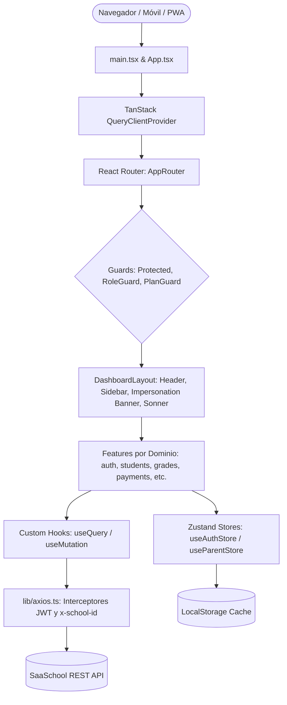
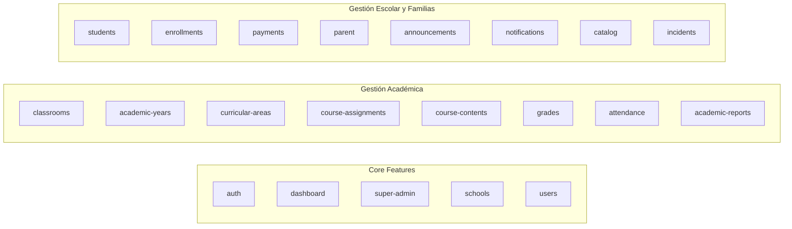

# SaaSchool Frontend — Documentación Técnica Integral de Arquitectura y Funcionalidades

> **Versión:** 1.2.0 (Jerarquía Curricular CNEB, Matriz con Pegado Excel y Conexiones Transversales)  
> **Plataforma:** SaaSchool — Frontend Web & Móvil B2B Multi-Rol (Administrador, Docente, Apoderado, Estudiante, SuperAdmin)  
> **Stack Tecnológico:** React 18.2 | TypeScript 5.3 (Strict Mode) | Vite 5.0 | Tailwind CSS 3.3  
> **Gestión de Estado:** TanStack Query v5 (Server State) | Zustand 4.4 (Client State con Persist)  
> **Formularios & Validación:** React Hook Form 7.48 + Zod 3.22 (@hookform/resolvers)  
> **UI Primitives & Notificaciones:** Radix UI | Lucide React | Sonner Toaster | html5-qrcode | ExcelJS & XLSX  

---

## 1. Arquitectura General y Filosofía Frontend

El frontend de **SaaSchool** está diseñado bajo los principios de **Feature-Sliced Design**, **Clean Architecture** y una estricta filosofía de **Diseño Semántico Multi-Tema**.

### 1.1 Principios Rectores Core
1. **Cero Colores Hardcodeados (Strict Semantic Variables):** No se utilizan clases como `bg-blue-500` o `text-gray-900` para estructura. Se emplean exclusivamente variables semánticas vinculadas a CSS (`bg-background`, `text-primary`, `bg-card`, `border-border`, `text-muted-foreground`), garantizando cambio instantáneo entre Modo Claro y Modo Oscuro y soporte para personalización de marca.
2. **Segregación de Estado:**
   * **Server State (TanStack Query):** Prohibido el uso de `useEffect` + `useState` para llamadas HTTP. Toda la caché, reintentos, refetch en segundo plano e invalidación reactiva se gestiona con React Query v5.
   * **Client State (Zustand):** Sesión del usuario, tokens, modo de impersonación del colegio y conmutación de hijos en el portal de padres.
   * **Local State (`useState`):** Exclusivo para estados efímeros de UI (modales abiertos/cerrados, acordeones, búsqueda local).
3. **UX Diferenciada por Rol:**
   * **Mobile-First para Padres y Alumnos:** Vistas táctiles optimizadas para celulares (asistencia, calificaciones bimestrales, pensiones, aula virtual y switcher de hijos).
   * **Desktop-First para Profesores y Dirección:** Matrices densas de información tipo Excel/Cubicol (matriz de calificaciones con rúbricas ponderadas, sábana mensual de asistencia 1..31, reportes oficiales SIAGIE).

---

## 2. Infraestructura Base, Seguridad y Ruteo

### 2.1 Cliente HTTP Centralizado (`src/lib/axios.ts`)
* **Instancia `api`:** Configurada con `baseURL: import.meta.env.VITE_API_URL || '/api'`.
* **Interceptor de Petición (Request):**
  * Inyecta automáticamente la cabecera `Authorization: Bearer <token>` extraída de `useAuthStore`.
  * **Soporte de Impersonación Técnica:** Si `user.role === 'SUPER_ADMIN'` y se seleccionó un colegio objetivo (`impersonatedSchool`), inyecta la cabecera `x-school-id: impersonatedSchool.id` para que el backend filtre automáticamente los datos de esa institución.
* **Interceptor de Respuesta (Response):**
  * Detecta respuestas con código `401 Unauthorized` (token expirado o sesión cerrada por el servidor), ejecuta `useAuthStore.getState().logout()` y redirige limpiamente a `/login`.

### 2.2 Gestión de Sesión Global (`src/store/useAuthStore.ts`)
* **Estado Administrado:**
  * `token: string | null`: JWT de sesión persistido en `localStorage`.
  * `user: User | null`: Datos del usuario autenticado (`id`, `email`, `role`, `firstName`, `lastNamePaternal`, `schoolId`, `documentId`, `mustChangePassword`).
  * `impersonatedSchool: ImpersonatedSchool | null`: Colegio al que el `SUPER_ADMIN` está brindando soporte técnico.
* **Acciones Principales:**
  * `setAuth(token, user)`: Guarda credenciales, purga la caché de React Query (`queryClient.clear()`) y setea el estado.
  * `updateUser(fields)`: Actualiza campos parciales del usuario (ej: tras cambiar contraseña).
  * `setImpersonatedSchool(school)`: Conmuta el colegio de soporte y purga la caché para evitar mezcla de datos.
  * `logout()`: Limpia `localStorage`, resetea el store y vacía la caché de React Query.

### 2.3 Store del Portal Familiar (`src/store/useParentStore.ts`)
* **Estado Administrado (Persistente con `zustand/middleware/persist`):**
  * `selectedChildId: string | null`: ID del hijo actualmente seleccionado en familias con múltiples estudiantes matriculados.
  * `viewMode: 'PARENT' | 'STUDENT'`: Permite alternar entre la vista ejecutiva de apoderado (pagos, asistencia, avisos) y la vista de estudiante (cursos, tareas del aula virtual, foros).
* **Acciones:** `setSelectedChildId(id)` y `setViewMode(mode)`.

### 2.4 Guardias de Navegación y Ruteo (`src/router/index.tsx`)
* **`ProtectedRoute`:** Redirige a `/login` si no existe `token`.
* **`PublicRoute`:** Redirige a `/dashboard` si el usuario ya cuenta con sesión activa.
* **`RoleGuard`:**
  * Valida que `user.role` pertenezca a la lista de roles permitidos (`allowedRoles`). Si no tiene permiso, redirige a `/dashboard`.
  * Parámetro `disallowStudents`: Bloquea el acceso a estudiantes en módulos puramente administrativos (ej. módulo de pagos).
* **`PlanGuard` (`src/components/ui/PlanGuard.tsx`):**
  * Evalúa el plan activo del colegio (`BASIC`, `PRO`, `ENTERPRISE`).
  * Si el colegio cuenta con un plan inferior al requerido (ej: `minPlan="PRO"` en Reportes Oficiales o Matriz de Notas), bloquea el renderizado y muestra una tarjeta explicativa con los beneficios del plan superior y un botón directo para contactar a soporte/ventas vía WhatsApp.

---

## 3. Layout Principal y Navegación (`src/layouts/DashboardLayout.tsx`)

El `DashboardLayout` estructura toda la experiencia visual post-autenticación:

1. **Barra de Soporte Técnico / Impersonación:** Si un `SUPER_ADMIN` está operando un colegio en modo soporte, muestra un banner superior distintivo con botón para salir del modo impersonación en 1 clic.
2. **Sidebar Categorizado Semánticamente (Dirección y Secretaría):**
   Para los roles `SCHOOL_ADMIN` y `ADMINISTRATIVE`, los enlaces de navegación están agrupados en 4 secciones limpias con encabezados semánticos (`text-xs font-semibold uppercase tracking-wider text-muted-foreground`):
   * **Operación Diaria:** Dashboard General (`/dashboard`), Asistencia y Kiosco QR (`/attendance`), Agenda e Incidencias (`/incidents`), Muro de Comunicados (`/announcements`), Directorio de Familias (`/directory`).
   * **Gestión Académica:** Matrícula SIAGIE / Alumnos (`/students`), Aula Virtual / Supervisión Pedagógica (`/virtual-classroom`), Calificaciones y Actas (`/grades`), Reportes Oficiales MINEDU (`/academic-reports`).
   * **Tesorería y Caja:** Cobranzas y Pensiones (`/payments`).
   * **Configuración Escolar:** Años Lectivos (`/academic-years`), Aulas y Secciones (`/classrooms`), Malla CNEB / Áreas (`/curricular-areas`), Carga Horaria Docente (`/teacher-assignments`), Rúbricas y Criterios (`/evaluation-criteria`).
3. **Navegación Aislada de Docentes (`TEACHER`):** Dashboard Docente, Asistencia Escolar, Matriz de Notas con Rúbricas, Asignaciones, Aula Virtual y Comunicados.
4. **Aislamiento Estricto del Rol Alumno (`STUDENT`):**
   * Vista fija y forzada en `viewMode = 'STUDENT'`.
   * Switch de modo familiar oculto, conmutador de hijos (`ChildSwitcher`) oculto y tarjeta financiera (`ChildFinancialCard`) oculta.
   * Acceso denegado a rutas financieras (`/payments`), permitiendo únicamente acceso autónomo a sus materias, tareas y foros (`/virtual-classroom`, `/grades`, `/announcements`, `/attendance`).
5. **Portal Familiar (`PARENT`):** Acceso integral al resumen multi-hijo, estado de pensiones, boletas, libreta de notas y aula virtual del menor.
6. **Campanita de Notificaciones (`NotificationBell`):** Componente interactivo con polling automático cada 45 segundos, contador badge de no leídas y panel desplegable.
7. **Banner Web Push Móvil (`MobilePushBanner`):** Detecta si el usuario navega desde un dispositivo móvil o navegador compatible y le solicita permisos para recibir alertas instantáneas de pagos y asistencia mediante el protocolo VAPID.
8. **Modal Forzado de Cambio de Clave (`ChangePasswordModal`):** Si el apoderado o alumno ingresó con su credencial por defecto (`mustChangePassword: true`), bloquea la interfaz hasta que establezca una contraseña segura.

---

## 4. Estructura y Módulos de Funcionalidad (Features)

A continuación se detalla la responsabilidad, vistas y lógica de cada una de las 21 features del frontend:

---

### Feature 1: `auth` — Autenticación y Seguridad
* **Página:** `LoginPage.tsx`
* **Componentes:** `ChangePasswordModal.tsx`
* **Esquemas:** `login.schema.ts` (valida email o número de documento y contraseña, soportando apoderados sin correo y acceso independiente de estudiantes con su DNI/código SIAGIE).
* **Hooks API:**
  * `useLogin()`: Ejecuta la mutación contra `POST /api/auth/login`. Al autenticar exitosamente, actualiza `useAuthStore` y redirige según el rol (SuperAdmin va a `/super-admin`, los demás a `/dashboard`).
  * `useChangePassword()`: Ejecuta `POST /api/auth/change-password` para cambio de clave voluntario o forzado.

---

### Feature 2: `dashboard` — Centro de Mando Diferenciado
* **Página:** `DashboardPage.tsx`
* **Componentes:** `TeacherDashboardView.tsx`
* **Lógica por Rol:**
  * **Si es `SUPER_ADMIN` (sin impersonar):** Redirige de inmediato a `/super-admin`.
  * **Si es `PARENT`:** Renderiza el portal de padres `ParentPortalPage.tsx`.
  * **Si es `TEACHER`:** Renderiza `TeacherDashboardView.tsx` con sus cursos asignados, accesos rápidos a pase de lista y registro de notas.
  * **Si es `SCHOOL_ADMIN` o `ADMINISTRATIVE`:** Muestra tarjetas estadísticas con total de estudiantes, aulas, comunicados vigentes y resumen financiero (facturado, recaudado, pendiente y porcentaje de cobranza en Soles `S/`).

---

### Feature 3: `super-admin` — Torre de Control Multi-Tenant
* **Página:** `SuperAdminPage.tsx`
* **Componentes:** `CreateSchoolModal.tsx`, `EditSchoolInfoModal.tsx`, `EditSchoolPlanModal.tsx`, `ResetAdminPasswordModal.tsx`.
* **Hooks API:** `useGetAllSchools`, `useCreateSchool`, `useUpdateSchoolPlan`, `useDeactivateSchool`, `useReactivateSchool`, `useUpdateSchoolInfo`, `useResetAdminPassword`.
* **Capacidades:**
  * Listado global de colegios clientes con métricas de alumnos y plan contratado.
  * Alta de nuevos colegios con creación transaccional del administrador inicial.
  * Conmutación en modo soporte (impersonación) para ingresar al colegio sin requerir su contraseña.
  * Suspensión y reactivación de suscripciones.
  * Modificación de planes (`BASIC`, `PRO`, `ENTERPRISE`) y fecha de vencimiento.
  * Reseteo de contraseña del director en caso de olvido.

---

### Feature 4: `schools` — Configuración Institucional
* **Componentes:** `SchoolSettingsModal.tsx`
* **Hooks API:** `useGetActiveSchool`, `useUpdateSchool`.
* **Capacidades:**
  * Edición de información del colegio (nombre, RUC, código modular, código de local, DRE/UGEL, dirección, teléfono, niveles operados `offeredLevels` y URL del logo).
  * Configuración de la política de **Bloqueo de Libretas por Morosidad** (`blockGradesOnOverdue`), permitiendo a Dirección restringir visualización y descarga de notas a familias con deudas vencidas.

---

### Feature 5: `users` — Directorio de Personal y Familias
* **Página:** `DirectoryPage.tsx`
* **Componentes:** `UserTable.tsx`, `UserFormModal.tsx`, `EditUserModal.tsx`.
* **Submódulo `family-relationships`:** `StudentParentsPanel.tsx`, `LinkParentModal.tsx`.
* **Hooks API:** `useUsers`, `useCreateUser`, `useUpdateUser`, `useDeactivateUser`, `useReactivateUser`, `useStudentParents`, `useParentStudents`, `useLinkParent`, `useDeleteRelationship`.
* **Capacidades:**
  * Directorio unificado de administradores, profesores y apoderados con filtros por rol y búsqueda.
  * Vinculación de apoderados con estudiantes indicando parentesco, representación legal y responsabilidad económica.

---

### Feature 6: `students` — Alumnos y Matrícula SIAGIE
* **Página:** `StudentsPage.tsx`
* **Componentes:** `StudentTable.tsx`, `StudentFichaModal.tsx`, `EnrollStudentModal.tsx`, `EditStudentModal.tsx`, `NominaSiagieModal.tsx`, `StudentQrCardModal.tsx`, `SectionQrCardsModal.tsx`, `StudentCertificateModal.tsx`.
* **Utilidad:** `exportNominaExcel.ts` (Generador de archivos Excel oficiales MINEDU).
* **Hooks API:** `useStudents`, `useStudent`, `useSiagieCatalogs`, `useRegisterFichaMatricula`, `useCreateStudent`, `useUpdateStudent`, `useDeleteStudent`, `useGetNominaMatricula`, `useGetMyChildren`, `useEnrollmentCertificate`, `useNoDebtCertificate`.
* **Capacidades:**
  * Ficha Única de Matrícula transaccional (Estudiante + Matrícula + Apoderado nuevo/existente) con validación de cuotas de alumnos por plan, soporte para documentos extranjeros (`PTP`, `BIRTH_CERTIFICATE`), becas (`customPensionAmount`, `discountReason`) y situación final SIAGIE (`finalSituation`).
  * Emisión e impresión oficial de **Constancias de Matrícula** y **Constancias de No Adeudo** (`StudentCertificateModal.tsx`) con código de verificación institucional y validación en tiempo real de solvencia económica.
  * Gestión de credenciales independientes de estudiantes (`passwordHash`, `mustChangePassword`) para acceso estudiantil autónomo a su aula virtual sin privilegios financieros.
  * Exportación de la Nómina Oficial de Matrícula SIAGIE en formato Excel con edad al 31 de marzo.
  * Generación e impresión de credenciales QR individuales y masivas por aula para el control de asistencia.

---

### Feature 7: `classrooms` — Aulas y Secciones
* **Página:** `ClassroomsPage.tsx`
* **Hooks API:** `useClassrooms`, `useCreateClassroom`, `useUpdateClassroom`, `useDeleteClassroom`.
* **Capacidades:**
  * Creación y administración de salones organizados por nivel (`INITIAL`, `PRIMARY`, `SECONDARY`), grado, sección (`A`, `B`, `Única`), turno y capacidad.
  * Asignación y cambio del docente tutor del aula.

---

### Feature 8: `academic-years` — Años Escolares
* **Página:** `AcademicYearsPage.tsx`
* **Hooks API:** `useAcademicYears`, `useActiveAcademicYear`, `useCreateAcademicYear`, `useUpdateAcademicYear`, `useDeleteAcademicYear`.
* **Capacidades:**
  * Apertura de periodos anuales con fechas de inicio y fin, soportando tanto estructura bimestral (4 bimestres) como trimestral (3 trimestres) mediante `periodType`.
  * Detección reactiva del año lectivo activo (`useActiveAcademicYear`) que sincroniza automáticamente la cantidad máxima de periodos (3 o 4) en todos los selectores de notas, reportes y aulas virtuales del sistema.
  * Protección contra eliminación si el año cuenta con matrículas activas.

---

### Feature 9: `curricular-areas` — Malla Curricular CNEB
* **Página:** `CurricularAreasPage.tsx`
* **Componentes:** `CourseCatalogSelect.tsx`.
* **Hooks API:** `useCurricularAreasPaginated`, `useCurricularAreas`, `useCreateCurricularArea`, `useUpdateCurricularArea`, `useDeleteCurricularArea`, `useSeedMineduCurriculum`, `useLoadDefaultCompetences`, `useCreateCompetence`, `useUpdateCompetence`, `useToggleCompetence`, `useDeleteCompetence`.
* **Capacidades:**
  * Siembra automática de la malla oficial MINEDU para Inicial, Primaria y Secundaria.
  * Creación de sub-áreas internas y autogeneración de competencias oficiales.
  * Activación y desactivación de competencias para periodos bimestrales.

---

### Feature 10: `course-assignments` — Carga Horaria Docente
* **Página:** `TeacherAssignmentsPage.tsx`
* **Componentes:** `TeacherMyCoursesView.tsx`.
* **Hooks API:** `useCourseAssignments`, `useMyCourseAssignments`, `useCreateCourseAssignment`, `useBulkAssignUnidocente`, `useSyncTeacherAssignments`, `useDeleteCourseAssignment`.
* **Capacidades:**
  * Asignación de profesores a materias (polidocencia).
  * Asignación masiva en 1 clic de todas las materias de un aula a un solo profesor (unidocencia).
  * Panel interactivo para sincronizar la carga horaria completa de un docente.

---

### Feature 11: `course-contents` — Aula Virtual y LMS Ligero
* **Páginas:** `StudentCoursesPage.tsx`, `VirtualClassroomSupervisionPage.tsx`.
* **Componentes:** `CourseContentCard.tsx`, `PublishContentModal.tsx`, `ForumCommentsModal.tsx`, `CourseTimelineModal.tsx`, `DocumentPreviewModal.tsx`, `StudentCourseCard.tsx`, `StudentCourseDetailView.tsx`, `TeacherCourseContentsModal.tsx`, `HomeworkSubmissionsModal.tsx`, `SubmitHomeworkModal.tsx`, componentes de supervisión pedagógica.
* **Hooks API:** `useGetCourseContents`, `useUploadMaterial`, `useCreateCourseContent`, `useDeleteCourseContent`, `useGetForumComments`, `useAddForumComment`, `useGetStudentCourses`, `useGetStudentTasks`, `useSubmitHomework`, `useGetHomeworkSubmissions`, `useGradeHomeworkSubmission`, `useSupervisionStats`, `useTeacherCompliance`, `useSupervisedFeed`.
* **Ciclo Completo de Tareas y Aula Virtual LMS:**
  1. **Publicación por Docente:** Mediante `PublishContentModal`, el profesor define título, descripción, bimestre, tipo (`LESSON_MATERIAL`, `HOMEWORK`, `FORUM`), fecha límite de entrega (`dueDate`) y adjuntos procesados con `useUploadMaterial` (hasta 30 MB con streaming a Google Drive y enlace seguro de visualización embebida `viewUrl`).
  2. **Entrega de Tarea por Alumno/Apoderado:** En `CourseContentCard` y `SubmitHomeworkModal`, el estudiante visualiza el estado en tiempo real (`Pendiente`, `Entregado a tiempo`, `Entregado fuera de fecha [Tardío]`, `Calificado: [Nota]`). Permite subir el archivo de solución, ingresar comentarios y registrar la entrega mediante `useSubmitHomework`. Al enviar, inyecta el `studentId` específico del hijo activo en `useParentStore` o el propio del alumno para evitar confusiones de entrega entre hermanos. Si la entrega supera `dueDate`, el backend marca automáticamente `isLate: true`.
  3. **Revisión y Calificación Docente:** A través de `HomeworkSubmissionsModal`, el profesor visualiza la lista completa de alumnos del aula con sus badges de entrega, abre el documento con `DocumentPreviewModal`, asigna la nota (numérica vigesimal 0..20 o literal SIAGIE `AD`, `A`, `B`, `C`) e introduce la retroalimentación cualitativa mediante `useGradeHomeworkSubmission`.
  4. **Feedback Reactivo Inmediato:** Al calificar, se dispara una notificación in-app para el estudiante/padre y la tarjeta refleja inmediatamente la calificación y observaciones formativas.
* **Supervisión Pedagógica:** Panel directivo para auditar el cumplimiento docente, publicaciones activas y feed institucional.

---

### Feature 12: `grades` — Calificaciones, Rúbricas y Libretas
* **Páginas:** `GradesPage.tsx`, `EvaluationCriteriaPage.tsx`.
* **Componentes:** `GradesMatrixGrid.tsx`, `ExcelGradesGrid.tsx`, `EvaluationCriteriaModal.tsx`, `ReportCardModal.tsx`, `SiagieConsolidatedModal.tsx`, `PredefinedCommentsModal.tsx`, `TeacherAdminGradesView.tsx`.
* **Hooks API:** `useGradeMatrix`, `useSaveGradeMatrix`, `useEvaluationCriteria`, `useCreateCriterion`, `useUpdateCriterion`, `useDeleteCriterion`, `useCompetenceConclusions`, `useSaveCompetenceConclusions`, `useReportCard`, `useSiagieSummary`, `usePeriodLockStatus`, `useTogglePeriodLock`.
* **Capacidades:**
  * Matriz interactiva de calificaciones tipo Excel con rúbricas y criterios ponderados, con selector dinámico de modo: Vigesimal (0-20) vs Literal (AD, A, B, C), defaulted según nivel educativo (Inicial/Primaria -> Literal; Secundaria -> Vigesimal).
  * Adaptabilidad completa al régimen periódico del colegio: conmuta dinámicamente entre Bimestres (1..4) y Trimestres (1..3) según el año lectivo.
  * Autoguardado local anti-cortes de energía (`saaschool_grades_draft_${courseAssignmentId}_${periodNumber}`) con banner reactivo de recuperación y botón para descartar borrador local.
  * Soporte para exoneración normativa (`EXO`) por estudiante o celda, pintando la fila con badge semántico "EXONERADO" y excluyéndola de promedios ponderados y KPIs del salón.
  * Guardado masivo atómico con comprobación de cierre de actas bimestrales y purga del borrador local en éxito.
  * Ingreso de conclusiones descriptivas con catálogo de frases predefinidas.
  * Emisión e impresión de la Libreta Oficial de Notas con conversión automática a escala literal (`AD`, `A`, `B`, `C`).
  * **Pantalla Informativa de Bloqueo por Morosidad (`402 Payment Required`):** En `ParentGradesView.tsx` y `ReportCardModal.tsx`, si la institución tiene habilitado el bloqueo por morosidad y el estudiante registra cuotas pendientes vencidas, se sustituye la libreta por una pantalla amigable que explica la restricción con directrices para regularizar en Tesorería.
  * Consolidación automática de sub-cursos hacia las áreas oficiales requeridas por el SIAGIE con regla de promoción automática en Inicial y 1° de Primaria.
  * Bloqueo y auditoría de actas bimestrales por Dirección.

---

### Feature 13: `attendance` — Asistencia Escolar y Kiosco QR
* **Página:** `AttendancePage.tsx`
* **Componentes:** `AttendanceSheetView.tsx`, `AttendanceMatrixGrid.tsx`, `AttendanceMonthlyReport.tsx`, `AttendanceScheduleModal.tsx`, `BulkAttendanceModal.tsx`, `CameraQrScanner.tsx`, `QrScannerModal.tsx`, `SectionQrCardsModal.tsx`, `StudentAttendanceModal.tsx`.
* **Hooks API:** `useAttendance`, `useAttendanceMatrix`, `useStudentAttendanceDetail`, `useAttendanceSummary`, `useAttendanceExport`, `useAttendanceSheet`, `useSaveAttendanceSheet`, `useRegisterAttendance`, `useRegisterBulkAttendance`, `useUpdateAttendance`, `useScanAttendance`, `useAttendanceScheduleConfigs`, `useUpsertAttendanceScheduleConfig`, `useCloseAttendance`.
* **Capacidades:**
  * Pase de lista diario por salón con cálculo de puntualidad y tardanzas.
  * Sábana mensual interactiva con los 31 días del mes.
  * Kiosco de puerta con escaneo por cámara de QR / código de barras o lector físico, clasificando automáticamente tardanzas según el horario escolar.
  * Cierre diario de faltas injustificadas manual o programado por cron.
  * Exportación de actas mensuales de asistencia.

---

### Feature 14: `payments` — Gestión de Cobranzas y Pensiones
* **Página:** `PaymentsPage.tsx`
* **Componentes:** `BulkObligationModal.tsx`, `CreateIndividualObligationModal.tsx`, `DailyCashCloseModal.tsx`, `RegisterTransactionModal.tsx`, `ReceiptModal.tsx`, `ReminderModal.tsx`, `EditObligationModal.tsx`.
* **Esquemas:** `payment.schema.ts`.
* **Hooks API:** `usePayments`, `useParentPayments`, `useFinancialSummary`, `useTransactions`, `useCreateObligation`, `useCreateIndividualObligation`, `useBulkCreateObligations`, `useDailyCashClose`, `useUpdateObligation`, `useRegisterTransaction`, `useDeleteTransaction`, `useTransactionReceipt`, `useSendReminder`, `useSendBulkReminders`.
* **Capacidades:**
  * Generación masiva del cronograma anual de pensiones con detección automática de montos de pensión personalizada (`customPensionAmount`) y becas integrales.
  * Creación de obligaciones individuales (`CreateIndividualObligationModal.tsx`) para emisión de deudas extraordinarias o matrículas extemporáneas.
  * Edición individual de cuotas y aplicación de descuentos/becas (`EditObligationModal.tsx`) con atajos rápidos (-50% Media Beca, -25% Hermanos, -10% Pronto Pago, Beca 100%) conectado a `PATCH /api/payments/obligations/:id`.
  * **Cobranza Preventiva por WhatsApp en 1 Clic:** Botón directo en la tabla de pagos que genera el enlace `https://wa.me/51...` con mensaje preformateado formal y cordial, incluyendo nombre del apoderado, alumno, concepto adeudado, monto en Soles y fecha de vencimiento.
  * **Arqueo y Cuadratura de Caja Diaria (`DailyCashCloseModal.tsx`):** Reporte de cierre de jornada con desglose por medio de pago (`CASH`, `BANK_TRANSFER`, `CREDIT_CARD`), monto total del día y tabla auditable de transacciones registradas.
  * Registro de cobros en caja diaria con numeración interna correlativa autogenerada (`REC-000001`).
  * Emisión e impresión de boletas/recibos de pago institucionales.
  * Anulación de cobros con recálculo automático de la deuda restante.
  * Envío de recordatorios de cobranza por correo electrónico HTML y notificación push al apoderado.

---

### Feature 15: `announcements` — Muro de Comunicados
* **Página:** `AnnouncementsPage.tsx`
* **Componentes:** `AnnouncementCard.tsx`, `CreateAnnouncementModal.tsx`.
* **Esquemas:** `announcement.schema.ts`.
* **Hooks API:** `useGetAnnouncements`, `useCreateAnnouncement`, `useUpdateAnnouncement`, `useDeleteAnnouncement`.
* **Capacidades:**
  * Publicación de comunicados con prioridades (`NORMAL`, `IMPORTANT`, `URGENT`), vigencia y segmentación por roles destino.

---

### Feature 16: `notifications` — Notificaciones In-App y Web Push
* **Componentes:** `NotificationBell.tsx`, `NotificationItem.tsx`, `MobilePushBanner.tsx`.
* **Hooks API:** `useGetNotifications`, `useMarkNotificationRead`, `useMarkAllNotificationsRead`, `useDeleteNotification`, `useGetVapidPublicKey`, `useSavePushSubscription`, `useSendTestPushNotification`.
* **Capacidades:**
  * Campanita interactiva en el header con polling inteligente cada 45s.
  * Banner de activación de notificaciones Push para celulares y tablets.

---

### Feature 17: `academic-reports` — Inteligencia Escolar y Reportes
* **Página:** `AcademicReportsPage.tsx`
* **Componentes:** `AcademicReportsHub.tsx`, `AcademicReportsSidebar.tsx`, `AcademicReportsFilterBar.tsx`, 10 componentes de reportes oficiales (`ConsolidatedGradesReport.tsx`, `DraftRegisterReport.tsx`, `MeritSalondReport.tsx`, `MeritGradeReport.tsx`, `ConductCommentsReport.tsx`, `ClassroomRosterReport.tsx`, `FamiliesByStateReport.tsx`, `FamiliesChildrenReport.tsx`, `FamiliesRelativesReport.tsx`, `StudentBirthdaysReport.tsx`), `reportExcelExport.ts`.
* **Hooks API:** `useReportCatalogClassrooms`, `useConsolidatedGradesReport`, `useDraftRegisterReport`, `useMeritClassroomReport`, `useMeritGradeReport`, `useConductCommentsReport`, `useClassroomRosterReport`, `useFamiliesByStateReport`, `useFamiliesWithChildrenReport`, `useFamiliesRelativesReport`, `useStudentBirthdaysReport`.
* **Capacidades:**
  * Visualización y exportación a Excel de los 10 reportes oficiales del sistema: Consolidado de notas (0021), Registro auxiliar borrador (0041), Orden de mérito de salón con Tercio Superior (0048), Orden de mérito por grado con Quinto Superior (0049), apreciaciones de conducta (0030), padrón de aula (0011), familias por convivencia (0001), hermanos en la institución (0002), parientes (0003) y cumpleaños (0019).
  * Protegido por `PlanGuard` (requiere plan `PRO` o `ENTERPRISE`).

---

### Feature 18: `parent` — Portal Familiar y Modo Alumno
* **Página:** `ParentPortalPage.tsx`
* **Componentes:** `ChildSwitcher.tsx`, `ChildOverviewCard.tsx`, `ChildAttendanceCard.tsx`, `ChildFinancialCard.tsx`, `ChildAnnouncementsCard.tsx`, `ChildGradesPreviewCard.tsx`, `ChildVirtualClassroomCard.tsx`, `ChildIncidentsCard.tsx`, `StudentDashboardView.tsx`, `ParentAttendanceView.tsx`, `ParentGradesView.tsx`.
* **Capacidades:**
  * Conmutador multi-hijo para familias con varios estudiantes en el colegio.
  * Consulta de asistencias, tardanzas, notas, pensiones e incidencias del menor con acuse de recibo.
  * Modo Alumno interactivo (`StudentDashboardView`) para que el estudiante acceda a sus cursos y tareas virtuales.

---

### Feature 19: `catalog` — Catálogos Oficiales MINEDU
* **Hooks API:** `useCatalogGrades`, `useCatalogCourses`.
* **Capacidades:** Carga de grados y cursos estándar del sistema sin requerir autenticación para inicializar filtros y selectores.

---

### Feature 20: `enrollments` — Matrículas Individuales
* **Hooks API:** `useEnrollments`, `useCreateEnrollment`.
* **Capacidades:** Registro directo de matrículas vinculando estudiante, año lectivo y aula.

---

### Feature 21: `incidents` — Agenda de Incidencias, Tópico de Enfermería y Citaciones
* **Página:** `IncidentsPage.tsx` (`/incidents`)
* **Componentes:** `CreateIncidentModal.tsx`, `ChildIncidentsCard.tsx`.
* **Hooks API:** `useIncidents`, `useCreateIncident`, `useAcknowledgeIncident`.
* **Capacidades:**
  * Bitácora institucional de incidencias conductuales, académicas, atenciones en tópico de enfermería y citaciones a padres de familia.
  * Filtros dinámicos por aula, alumno, categoría (`BEHAVIORAL`, `ACADEMIC`, `NURSING`, `CITATION`) y nivel de severidad (`LOW`, `MEDIUM`, `HIGH`, `CRITICAL`).
  * Despacho automático de notificaciones Web Push y registros in-app al registrar incidentes con `notifyParents: true`.
  * Visualización y acuse de recibo formal en 1 clic para apoderados desde el portal familiar.

